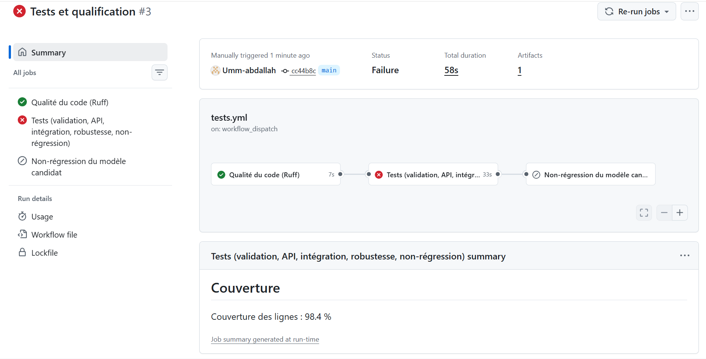

# Rapport de qualification du prototype CreditRisk

Après l'ensemble des tests, j'estime que le prototype peut passer en phase pilote avec la version 1.3.0 du modèle, à condition qu'il reste un outil d'aide à la décision et que l'agent de crédit garde la main. Les 209 tests de ma suite passent et la couverture du code atteint 98 %. J'ai quand même relevé 8 anomalies, dont 2 critiques, et l'une d'elles n'est toujours pas réglée : le modèle laisse passer 83 % des défauts sur les crédits de 24 mois et plus.

## 1. Contexte et système testé

Le système doit estimer le risque qu'un demandeur de crédit ne rembourse pas. Il reçoit cinq informations sur le demandeur, les contrôle, calcule quelques variables supplémentaires, puis le modèle renvoie une probabilité de défaut que l'API traduit en classe de risque pour l'agent.

J'ai découpé le code en quatre modules, comme le demandait le sujet :

| Composant | Fichier | Ce qu'il fait |
| --- | --- | --- |
| Validation | `app/validation.py` | Vérifie le type et les bornes de chaque champ, refuse les champs en trop, contrôle que l'ancienneté est cohérente avec l'âge |
| Prétraitement | `app/preprocessing.py` | Calcule le taux d'effort (mensualité divisée par le revenu) et le logarithme du revenu et du montant, soit 8 variables en tout |
| Modèle | `app/prediction.py`, dossier `models/` | Charge le modèle en vérifiant son empreinte SHA-256, contrôle les dimensions et la sortie |
| API | `app/main.py` | Expose `GET /health`, `POST /predict` et `GET /model-info`, avec un format d'erreur unique |

Pour les données, j'ai choisi un jeu synthétique de 6 000 dossiers que je génère moi-même (graine 42, 28,1 % de défauts, 4 200 dossiers pour l'entraînement et 1 800 pour le test). Ce jeu me permet de tester le système, mais il ne dit rien de la performance qu'aurait un vrai modèle de crédit sur une vraie clientèle.

Pour pouvoir tester la non-régression, j'ai entraîné quatre versions du modèle :

| Version | Algorithme | Pourquoi je l'ai créée |
| --- | --- | --- |
| 1.0.0 | Régression logistique avec pondération des classes | Version de référence, celle qui tourne dans l'API |
| 1.1.0 | Gradient boosting (HistGradientBoosting) | Une évolution « normale » du modèle |
| 1.2.0 | Régression logistique sans pondération des classes | Simuler une erreur de code qui dégrade le modèle |
| 1.3.0 | Gradient boosting avec contraintes de monotonie | Corriger l'anomalie ANO-02 trouvée pendant les tests |

L'API classe la probabilité en trois niveaux : faible en dessous de 0,30, modéré entre 0,30 et 0,60, élevé à partir de 0,60. Chaque réponse rappelle que la décision finale appartient à l'agent.

## 2. Stratégie de test et matrice de traçabilité

Je suis parti des 7 exigences du sujet et j'en ai ajouté 11. Elles sont couvertes par 212 cas de test, que j'ai rangés en six fichiers :

| Niveau | Fichier | Nombre de cas | Techniques utilisées |
| --- | --- | --- | --- |
| Unitaire | `test_validation.py` | 52 | Classes d'équivalence, valeurs limites |
| Fonctionnel | `test_api.py` | 40 | Vérification du contrat HTTP |
| Intégration | `test_integration.py` | 22 | Espion sur le pipeline, pannes simulées avec monkeypatch |
| Robustesse | `test_robustness.py` | 85 | Entrées invalides et inhabituelles, fuzzing avec graine fixe, tests métamorphiques |
| Non-régression | `test_regression.py` | 12 | Comparaison à la version 1.0.0 avec des tolérances fixées à l'avance |
| Démonstration CI | `test_echec_volontaire.py` | 1 | Test qui échoue exprès quand on l'active |

Pour prioriser, j'ai classé en P1 tout ce qui peut mener à une mauvaise décision de crédit, à une fuite d'information technique, à une panne non signalée ou à une régression qui passerait inaperçue. Le reste, qui touche au respect du contrat ou à la qualité sans conséquence directe sur la décision, est en P2. Les tests P1 bloquent les Pull Requests.

| ID | Exigence | Résultat attendu | Risque | Priorité | Cas de test | Statut |
| --- | --- | --- | --- | --- | --- | --- |
| EX01 | Âge entier de 18 à 75 ans | Valeur hors limites rejetée (422) | Évaluer un mineur | P1 | test_ex01, API03, API08, ROB04 | Conforme |
| EX02 | Revenu numérique, fini et positif | Erreur contrôlée 422 | Texte converti sans prévenir | P1 | test_ex02, API04, ROB02, ROB03 | Conforme |
| EX03 | Durée entière de 1 à 60 mois | 12,5 et 12.0 rejetés | Mensualité faussée | P1 | test_ex03, API06, ROB04 | Conforme |
| EX04 | Probabilité finie entre 0 et 1 | Contrat respecté | Décision incohérente | P1 | API01, INT11, ROB07, REG07 | Conforme |
| EX05 | Modèle indisponible signalé | 503 sur les 3 endpoints | Réponses fausses | P1 | API09, INT07 | Conforme |
| EX06 | Entrée incomplète rejetée | 422 avec le champ manquant | Valeur imputée sans contrôle | P1 | test_ex06, API02, ROB01, INT08 | Conforme |
| EX07 | Une nouvelle version ne dégrade pas les critères critiques | Rappel et F1 ne baissent pas de plus de 0,03, AUC de plus de 0,02 | Défauts non détectés | P1 | REG01 à REG09 | Conforme avec 1.3.0 |
| EX08 | Champs non prévus refusés | 422 extra_forbidden | Variable sensible ajoutée en douce | P2 | test_ex08, API07, ROB06 | Conforme |
| EX09 | Ancienneté cohérente avec l'âge | 422 si elle dépasse l'âge moins 14 ans | Donnée fausse ou frauduleuse | P2 | test_ex09, ROB04 | Conforme |
| EX10 | Montant entre 10 000 et 500 millions de FCFA | 422 hors bornes | Montant absurde évalué | P1 | API05, API08, ROB04 | Conforme après ANO-03 |
| EX11 | Entrée inhabituelle signalée et renvoyée vers l'agent | 200, alerte et décision manuelle | Décision prise sur une extrapolation | P1 | test_ex11, ROB05 | Conforme après ANO-04 |
| EX12 | Toutes les erreurs au même format | 400, 404 et 405 au format du contrat | Erreur que le client ne sait pas lire | P2 | API10, API13, ROB03, ROB06 | Conforme après ANO-01 |
| EX13 | Métadonnées fidèles au modèle chargé | Version, variables et SHA-256 cohérents | Mauvaise version en service | P2 | API12, API15, INT06, REG02, REG05 | Conforme |
| EX14 | Pas de trace technique, requêtes traçables | Message générique et X-Request-ID | Fuite d'information | P1 | INT09 à INT12, API14 | Conforme |
| EX15 | Résultats reproductibles | Même entrée, même sortie | Résultat impossible à auditer | P1 | ROB07, REG04, REG06, INT14 | Conforme |
| EX16 | Le risque évolue dans le bon sens | Monotonie avec une tolérance de 0,02 | Bons profils refusés | P2 | ROB08 | Non conforme en 1.0.0 (ANO-02), conforme en 1.3.0 |
| EX17 | Temps de réponse adapté aux agences | P95 sous 200 ms avec 20 requêtes simultanées | Agents qui attendent | P2 | benchmark, Locust | Conforme |
| EX18 | Chaque Pull Request est vérifiée automatiquement | Ruff, Pytest et couverture d'au moins 90 % | Régression fusionnée | P2 | tests.yml | Conforme en local |

Les préconditions, les données d'entrée et les résultats attendus de chaque cas sont détaillés dans `docs/plan_de_test.md`.

## 3. Tests fonctionnels et d'intégration

Les 40 tests fonctionnels et les 22 tests d'intégration passent tous. Pour chaque réponse d'erreur, j'ai écrit une fonction `verifier_erreur_propre` qui vérifie la structure `{erreur, id_requete}` et qui cherche dans la réponse des mots comme `Traceback`, un chemin de fichier, `site-packages` ou un nom d'exception. Si l'un d'eux apparaît, le test échoue.

### Scénarios imposés pour l'API

| Scénario | Entrée | Code attendu | Contenu attendu | Résultat |
| --- | --- | --- | --- | --- |
| Requête valide | 35 ans, 250 000, 1 000 000, 12 mois, 4 ans | 200 | 7 champs, probabilité entre 0 et 1 | 200, probabilité 0,354, risque modéré |
| Champ obligatoire absent | Chacun des 5 champs retiré à tour de rôle | 422 | DONNEES_INVALIDES, type missing | Conforme (5 cas) |
| Âge négatif | age = -5 | 422 | Erreur sur age | Conforme |
| Revenu en texte | "250000", "deux cent mille", "" | 422 | float_type, pas de conversion | Conforme (3 cas) |
| Montant nul ou négatif | 0, -1, -1 000 000 | 422 | Erreur sur montant_credit | Conforme (3 cas) |
| Durée non entière | 12.5, 12.0, "12" | 422 | int_type | Conforme (3 cas) |
| Champ en trop | sexe = "F" | 422 | extra_forbidden | Conforme |
| Valeurs très élevées | De 10^4 à 10^15 | 422, ou 200 si la valeur reste dans les bornes | less_than_equal, ou alerte hors domaine | Conforme (5 cas) |
| Modèle indisponible | Fichier du modèle absent | 503 | MODELE_INDISPONIBLE sur les 3 endpoints | Conforme (3 cas) |
| Requête mal formée | JSON coupé, liste, texte, null, corps vide | 400 ou 422 | REQUETE_MAL_FORMEE ou DONNEES_INVALIDES | Conforme (8 cas) |

J'ai ajouté cinq scénarios pour `/health`, `/model-info`, les erreurs 404 et 405, le renvoi de l'en-tête `X-Request-ID` et la cohérence de la version entre les endpoints.

### Tests de bout en bout

Pour le scénario principal, j'ai placé un espion sur la fonction de prétraitement. Avec une seule requête, je vérifie que les données arrivent validées et bien typées, que le vecteur contient 8 variables avec un taux d'effort de 0,333, que la probabilité renvoyée est la même que celle du modèle appelé directement (à 10^-6 près) et que l'empreinte SHA-256 affichée par `/model-info` correspond bien au fichier chargé. Un autre test s'assure que le prétraitement est le même à l'entraînement et dans l'API.

J'ai ensuite simulé des pannes pour voir comment l'API réagit :

| Panne simulée | Réponse obtenue |
| --- | --- |
| Modèle absent, corrompu, empreinte modifiée, métadonnées absentes, objet sans predict_proba | 503 MODELE_INDISPONIBLE |
| Variable perdue après la validation, erreur dans le prétraitement | 422 PRETRAITEMENT_IMPOSSIBLE |
| Mauvaises dimensions (1 × 5, 1 × 9, 2 × 8, vecteur à plat) | 500 ERREUR_PREDICTION |
| Exception dans le modèle, sortie NaN, infinie, 1,5 ou -0,2 | 500 ERREUR_PREDICTION |
| Bug inattendu dans la couche applicative | 500 ERREUR_INTERNE avec un message générique |

Dans les messages d'erreur que j'injecte, j'ai volontairement mis des faux secrets (« Traceback secret », un chemin `/home/...`, une clé « confidentielle »). Aucun ne ressort dans la réponse, et l'API répond normalement à la requête suivante.

## 4. Robustesse et anomalies

Au premier lancement, 12 des 85 tests de robustesse ont échoué. Après mes corrections, il n'y a plus d'échec. Deux anomalies du modèle 1.0.0 restent connues et je les suis avec des tests marqués `xfail` en mode strict, qui me préviendront le jour où elles seront corrigées. Les sorties avant et après correction sont dans `reports/preuves/`.

J'ai séparé deux cas. D'un côté, les entrées invalides, que l'API doit refuser : valeurs `null`, textes, booléens, listes, NaN, Infinity, 1e400, entiers de 5 000 chiffres, mauvais schéma, clés en double, valeurs juste au-dessus ou en dessous des bornes. De l'autre, les entrées valides mais inhabituelles, comme un demandeur de 75 ans, un revenu de 10 millions de FCFA ou un crédit sur 60 mois. Celles-là sont traitées, mais l'API ajoute une alerte et renvoie le dossier vers une analyse manuelle. J'ai complété avec un fuzzing sur 500 demandeurs tirés au hasard (graine fixe) et des tests métamorphiques qui vérifient que le risque varie dans le bon sens.

| ID | Gravité | Trouvée par | Ce que j'ai observé | Correction | Statut |
| --- | --- | --- | --- | --- | --- |
| ANO-02 | Critique | ROB08 | Avec le modèle 1.0.0, le risque monte avec le revenu : 0,316 à 500 000 FCFA, 0,454 à 1,8 million et 0,99 à 10 millions (risque élevé) | Modèle 1.3.0 avec contraintes de monotonie, plus la correction ANO-04 | Ouverte en 1.0.0, corrigée en 1.3.0 |
| ANO-05 | Critique (métier) | Analyse par segment | Taux de faux négatifs de 5,4 % sous 12 mois, 51,6 % entre 12 et 23 mois et 83,0 % à partir de 24 mois, pour 24,7 % au global | Seuil par segment, variables supplémentaires, avis du métier | Ouverte |
| ANO-01 | Majeure | ROB03, ROB06 | Les erreurs 400, 404 et 405 sortaient au format FastAPI par défaut, sans code ni identifiant | Gestionnaire d'erreurs HTTP qui applique le format du contrat | Corrigée |
| ANO-03 | Majeure | ROB04 | Un montant de 0,0001 FCFA était accepté, avec une probabilité de 0,96 et un risque élevé | Montant minimum de 10 000 FCFA | Corrigée |
| ANO-04 | Majeure | ROB05 | L'alerte hors domaine s'affichait mais la décision suggérée ne changeait pas | Décision analyse_manuelle_hors_domaine | Corrigée |
| ANO-06 | Majeure | REG01 | Version 1.2.0 : rappel de 0,607 contre 0,753, alors que le F1 augmentait | Version rejetée | Bloquée |
| ANO-07 | Mineure | REG03 | Version 1.1.0 : écart de probabilité de 0,212 sur le jeu de référence, au-delà de la tolérance de 0,15 | À analyser avant toute mise en service | Bloquée |
| ANO-08 | Mineure | ROB08 | Version 1.0.0 : risque de 0,294 à 100 000 FCFA puis 0,283 à 300 000 FCFA | Écart sous la tolérance de 0,02 | Acceptée |

L'anomalie ANO-02 m'a le plus surpris. Aucune métrique globale ne la montrait, et pourtant un demandeur avec un bon revenu se serait retrouvé classé à risque élevé. Ce sont les tests métamorphiques qui l'ont fait apparaître. Le registre complet se trouve dans `reports/registre_anomalies.md`.

## 5. Non-régression

Sur les trois versions candidates, seule la 1.3.0 respecte toutes les tolérances. La 1.2.0 est bloquée à cause d'une baisse du rappel de 0,146, que je n'aurais pas vue en regardant seulement le F1, puisqu'il augmente.

Ma référence, c'est le modèle 1.0.0 avec ses métriques sur les 1 800 dossiers de test et les probabilités qu'il donne sur un jeu de 60 dossiers fixes que j'appelle le jeu « or ». J'ai écrit les tolérances dans `reference/tolerances.json` avant de lancer la moindre comparaison : le rappel et le F1 ne doivent pas baisser de plus de 0,03, l'AUC de plus de 0,02, la probabilité d'un dossier ne doit pas bouger de plus de 0,15, et au plus 20 % des dossiers peuvent changer de classe de risque.

| Version | Rappel | Précision | F1 | AUC | Écart de probabilité max | Changements de classe | Verdict |
| --- | --- | --- | --- | --- | --- | --- | --- |
| 1.0.0 (référence) | 0,753 | 0,644 | 0,694 | 0,884 | 0 | 0 % | Référence |
| 1.1.0 | 0,741 | 0,637 | 0,685 | 0,876 | 0,212 | 17 % | Non conforme |
| 1.2.0 | 0,607 | 0,832 | 0,702 | 0,884 | 0,231 | 15 % | Non conforme |
| 1.3.0 | 0,749 | 0,629 | 0,684 | 0,879 | 0,144 | 12 % | Conforme |

Les autres contrôles demandés passent avec les versions 1.0.0 et 1.3.0. Les tests fonctionnels et d'intégration repassent avec le modèle candidat (73 tests réussis avec la 1.3.0). Les 60 dossiers du jeu « or » donnent des réponses conformes au contrat. Après sauvegarde et rechargement, les probabilités sont exactement les mêmes. Si je réentraîne avec la même graine, j'obtiens la même empreinte SHA-256. Enfin, les métriques écrites dans les métadonnées correspondent à celles que je recalcule.

J'ai aussi ajouté un test qui vérifie que mon contrôle détecte bien la version dégradée 1.2.0. Comme ça, je teste aussi que les tests de non-régression font leur travail. Le rapport détaillé est dans `reports/rapport_non_regression.md`.

## 6. Performance

L'objectif est atteint. Avec 20 requêtes simultanées, le P95 de `/predict` est de 40,6 ms alors que je visais 200 ms, avec 557 requêtes par seconde et aucune erreur.

J'ai fixé l'objectif avant de mesurer : P95 sous 200 ms avec 20 requêtes simultanées, au moins 50 requêtes par seconde et 0 % d'erreur. Je suis parti de l'hypothèse d'une cinquantaine d'agents, dont 40 % utilisent l'outil au même moment aux heures de pointe. Avec 200 ms côté serveur, le temps total reste sous la seconde même si le réseau de l'agence est lent.

Les mesures ont été faites sur une machine virtuelle Linux (Intel Xeon 2,30 GHz, 2 cœurs, 7 Go de RAM) avec Python 3.13.18, FastAPI 0.162.2 et scikit-learn 1.9.1. Le serveur uvicorn tournait avec un seul worker en local, sans TLS, et le client httpx était sur la même machine.

| Mesure | P50 | P95 | P99 |
| --- | --- | --- | --- |
| Inférence du modèle seul (3 000 appels) | 0,15 ms | 0,31 ms | 0,47 ms |
| Validation, prétraitement et inférence | 0,16 ms | 0,22 ms | 0,26 ms |
| API en séquentiel (500 requêtes) | 1,98 ms | 2,96 ms | 6,05 ms |

| Requêtes simultanées | P95 (ms) | Débit (req/s) | Erreurs |
| --- | --- | --- | --- |
| 1 | 2,9 | 452 | 0 % |
| 5 | 14,8 | 476 | 0 % |
| 10 | 21,9 | 620 | 0 % |
| 20 | 40,6 | 557 | 0 % |
| 50 | 136,5 | 482 | 0 % |

Avec Locust, j'ai simulé 50 utilisateurs ajoutés progressivement pendant 30 secondes. J'ai obtenu 9 606 requêtes, environ 320 requêtes par seconde, aucun échec et un P95 de 19 ms sur `/predict`.

Le modèle lui-même prend moins d'une demi-milliseconde, le temps est surtout passé dans la partie HTTP. Le débit plafonne autour de 500 à 600 requêtes par seconde, puis la latence augmente parce que les requêtes attendent leur tour sur l'unique worker. Pour monter en charge, il suffirait d'ajouter des workers. Ces chiffres montrent que le code n'a pas de goulet d'étranglement, mais ils devront être refaits sur le vrai serveur.

## 7. Automatisation avec GitHub Actions

Le workflow `.github/workflows/tests.yml` se lance à chaque push sur `main`, à chaque Pull Request, et on peut aussi le déclencher à la main. Il contient trois jobs qui s'enchaînent, et si l'un échoue les suivants ne se lancent pas :

1. Qualité du code avec `ruff check` et `ruff format --check`.
2. Tests : vérification de l'empreinte SHA-256 des modèles, puis la suite complète avec `pytest-cov` et un seuil de couverture de 90 %. Les rapports JUnit, XML et HTML sont publiés en artefacts.
3. Non-régression : le rapport comparatif des versions s'affiche dans le résumé du job, puis le modèle candidat (1.3.0 par défaut) passe le contrôle bloquant.

Pour que l'environnement soit reproductible, j'ai fixé Python 3.13 et toutes les versions des bibliothèques dans `requirements.txt` et `requirements-dev.txt`, et les modèles de test sont versionnés dans le dépôt. Le seul réentraînement fait en CI est celui du test de reproductibilité, une régression logistique qui prend moins de 2 secondes. La suite complète tourne en 6 secondes environ.

Pour montrer qu'un test qui échoue bloque bien le workflow, j'ai ajouté une option `forcer_echec` au déclenchement manuel. Elle active `test_echec_volontaire`, qui fait échouer le job de tests. En local, `FORCER_ECHEC=1 pytest` renvoie bien le code de sortie 1 (sortie dans `reports/preuves/echec_volontaire.txt`). Le modèle 1.2.0 fait lui aussi échouer le contrôle de non-régression.

En local, Ruff ne trouve aucune erreur, 209 tests passent, 1 est ignoré et 2 sont en `xfail`, avec 98 % de couverture en lignes et en branches. Le dépôt est en ligne à l'adresse https://github.com/Umm-abdallah/CreditRisk-Test. La première exécution du workflow sur GitHub est passée au vert sur les trois jobs (qualité, tests et non-régression).

J'ai ensuite lancé le workflow à la main avec l'option `forcer_echec`. Le job de tests a échoué sur `test_echec_volontaire` (1 échec et 209 tests réussis) et le job de non-régression ne s'est pas lancé. Le workflow bloque donc bien dès qu'un test échoue.

## 8. Limites, recommandations et conclusion

### Limites

- Les données sont synthétiques. Les métriques obtenues (rappel de 0,753, AUC de 0,884) décrivent le générateur que j'ai écrit, pas une vraie clientèle.
- Je n'ai pas évalué l'équité ni la conformité légale. Je n'avais aucune variable protégée, et l'âge, que le modèle utilise, pourrait déjà poser un problème de discrimination.
- La sécurité est restée hors du périmètre : il n'y a ni authentification, ni limitation du nombre de requêtes, ni TLS.
- Les mesures de performance viennent d'une seule machine, sur laquelle le client et le serveur se partageaient 2 cœurs.
- Les seuils de 0,30, 0,50 et 0,60 n'ont pas été validés par la direction des risques.
- Mes tests vérifient le système à un instant donné. Ils ne suivent pas l'évolution de la clientèle dans le temps.

### Recommandations

| Priorité | Recommandation | Lien |
| --- | --- | --- |
| 1 | Mettre en service le modèle 1.3.0, qui est monotone et qui passe la non-régression | ANO-02 |
| 1 | Réduire les faux négatifs sur les crédits longs avec un seuil ou un modèle par tranche de durée, des variables en plus, et un rappel minimum par segment ajouté aux tests de non-régression | ANO-05 |
| 1 | Réentraîner et requalifier le modèle sur des données historiques réelles, avec une validation dans le temps | Limites |
| 2 | Faire un audit d'équité (âge, genre, zone) et une revue juridique avant toute utilisation pour décider | Limites |
| 2 | Ajouter une authentification, une limitation du nombre de requêtes et TLS, et enregistrer chaque prédiction avec sa version | EX14 |
| 2 | Surveiller en production la dérive des entrées, la part d'alertes hors domaine et les défauts réellement constatés | Limites |
| 3 | Refaire les mesures de performance sur le serveur cible avec plusieurs workers | EX17 |

### Conclusion

Sur le plan technique, je donne un avis favorable. Avec la version 1.3.0, le système respecte ses 18 exigences : il rejette proprement les entrées invalides, signale ses pannes sans rien laisser fuiter, donne des résultats reproductibles, repère les régressions et répond bien plus vite que l'objectif.

Sur le plan métier, je ne recommande qu'un pilote encadré. Le modèle peut servir d'aide à la décision, mais c'est l'agent qui décide, et une analyse manuelle doit être obligatoire pour les crédits de 12 mois et plus ainsi que pour toute alerte hors domaine. Le modèle ne doit pas accorder ni refuser de crédit automatiquement tant que l'anomalie ANO-05 n'est pas corrigée et qu'il n'a pas été requalifié sur des données réelles.

## 9. Question de synthèse

*Tous les tests fonctionnels et techniques passent, mais le modèle a encore un taux élevé de faux négatifs pour certains profils. Peut-on recommander sa mise en production ?*

Pour moi, la réponse est non, en tout cas pas pour prendre des décisions. Et ce n'est pas une situation théorique dans mon projet : toute ma suite de tests est au vert, et le modèle rate pourtant 83 % des défauts sur les crédits de 24 mois et plus.

Les tests techniques prouvent que le logiciel fait ce qu'on lui a demandé. Il valide les données, calcule, répond vite, signale ses pannes et donne toujours le même résultat pour la même entrée. Ils prouvent donc que le système est conforme à sa spécification, mais ils ne disent pas si les décisions qu'il suggère sont bonnes. Avec un rappel global de 0,753, le modèle paraît correct alors qu'il ne voit presque aucun défaut sur un segment entier.

Côté métier, un faux négatif veut dire qu'on accorde un crédit à quelqu'un qui ne remboursera pas. L'institution perd de l'argent, son portefeuille à risque se dégrade, et le client se retrouve surendetté. En plus, les crédits longs sont souvent ceux qui portent les plus gros montants, donc ce sont les pertes les plus lourdes. Ce qu'il faudrait exiger, c'est un rappel acceptable sur chaque segment, et pas seulement en moyenne. Ce critère ne figurait pas dans le cahier des charges, et c'est pour ça que les tests ne l'ont pas bloqué.

Les risques sont de plusieurs ordres. Il y a le risque financier, avec des pertes concentrées sur un segment, et le risque pour les clients, qui peuvent être poussés au surendettement alors qu'ils sont souvent vulnérables. Il y a aussi un risque d'équité : si les profils mal évalués correspondent à un groupe précis (les jeunes, les femmes, une zone rurale), l'erreur devient discriminatoire. Enfin, les agents risquent de faire trop confiance à un outil présenté comme « testé » et de relâcher leur vigilance.

Avant d'aller plus loin, je mettrais en place les contrôles suivants :

1. Ajouter aux exigences un rappel minimum par segment (durée, montant, âge, secteur d'activité, zone), défini avec la direction des risques, et en faire un critère bloquant de la non-régression.
2. Chercher la cause : variables manquantes, seuil unique mal adapté, trop peu de défauts sur crédits longs dans les données d'entraînement. Puis essayer un seuil par segment ou un modèle spécifique.
3. Requalifier le modèle sur des données réelles avec une validation dans le temps, puis faire un audit d'équité et une revue de conformité.
4. Pendant le pilote, imposer une analyse humaine sur les segments concernés, suivre les défauts réels et fixer à l'avance les critères qui feraient arrêter l'expérience.

Pour conclure, les tests me permettent de dire que le système fonctionne, pas que ses décisions sont bonnes. La mise en production reste une décision du métier, qui doit s'appuyer sur ces résultats techniques sans s'y limiter.
